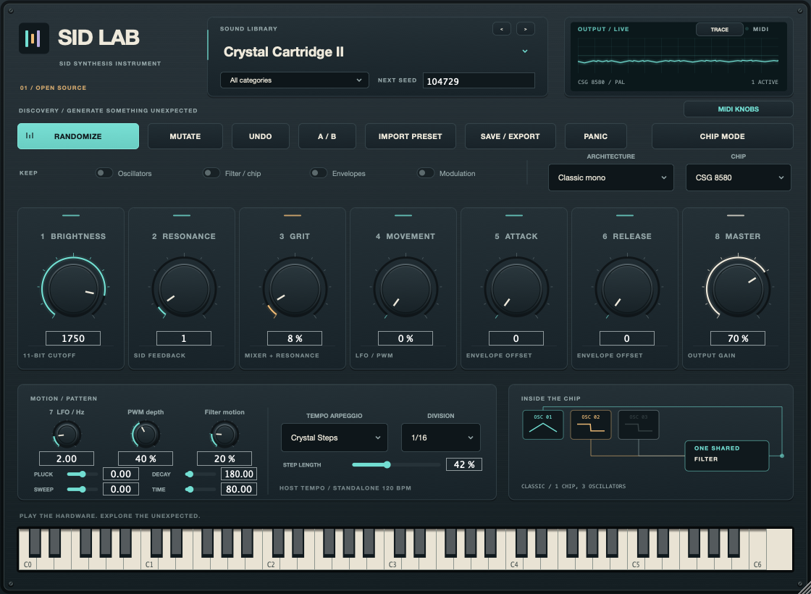
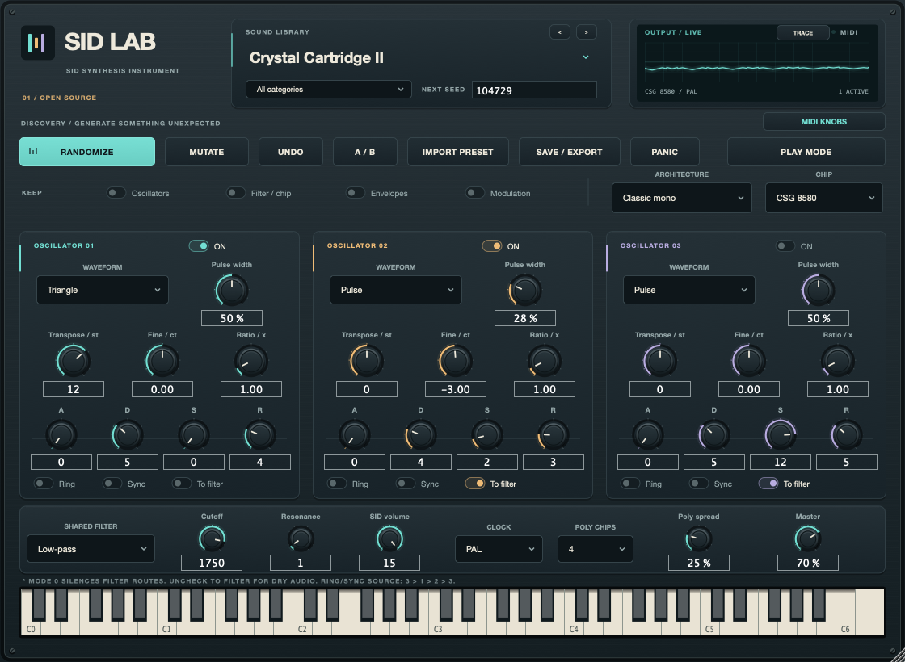

# SID Lab

**A playable SID synthesizer for Apple Silicon Macs — standalone and Audio Unit.**

Explore the sound of the Commodore 64's MOS 6581 and CSG 8580 chips through a modern instrument: 104 original sounds, a full chip editor, seeded sound discovery, retro drum kits and live visualizations. Play from a MIDI keyboard, use the on-screen keys, or record in GarageBand.



SID Lab uses the actual **[libresidfp](https://github.com/libsidplayfp/libresidfp)** SID emulator and **[JUCE](https://juce.com/)**. The emulation is the work of **Dag Lem, Antti S. Lankila, Ken Händel and Leandro Nini**. JUCE was created by **Julian “Jules” Storer** and developed by **Raw Material Software and the JUCE contributors**. Their work makes this instrument possible. See [Credits](CREDITS.md), [Third-party notices](THIRD_PARTY_NOTICES.md) and [Licensing](LICENSES.md).

## What you can play

- **Chip voices:** triangle, saw, pulse, noise, combined tonal waveforms, oscillator sync, ring modulation, SID envelopes and the shared filter.
- **Classic mono or enhanced polyphony:** one three-oscillator SID, or up to four complete chips for chords.
- **104 original presets:** basses, leads, arpeggios, pads, effects, experimental sounds, disco sequencers, eight drum kits and 80s synth-pop textures.
- **Sound discovery:** seeded Randomize and Mutate, section locks, Undo and A/B comparison.
- **Your own sounds:** export/import complete `.sidlab.json` presets; GarageBand projects also store instrument state.
- **Hands-on control:** velocity, pitch bend, sustain and eight learnable rotary MIDI controls.
- **Three live displays:** waveform Trace, Spectrum and Orbit, driven by the actual output.

No Commodore ROMs, SID song files, sampled songs or commercial preset libraries are needed. Polyphony, the arpeggiator, percussion recipes and modulation macros are SID Lab extensions around the emulator.

## Requirements and build

| | Supported |
| --- | --- |
| Computer | Apple Silicon Mac, native arm64 shell |
| System | macOS 12 or later build target; validate on your own OS/host |
| Formats | Standalone app and AUv2 instrument |
| Build tools | Apple Command Line Tools or Xcode, CMake 3.25+, Python 3.9+, Git |
| Not provided | Intel builds, Windows/Linux, VST or AUv3 |

Clone this repository **with its submodules**:

```sh
git clone --recurse-submodules https://github.com/hakanschon/sid-lab.git
cd sid-lab
./scripts/build.sh
```

The build verifies dependency revisions, builds and tests the instrument, signs local copies ad hoc and creates the AU/standalone ZIPs plus a **complete source archive** in `build/`. See [Building](BUILDING.md) for tool installation and troubleshooting. GitHub's automatic “Source code” downloads omit submodules; use the complete SID Lab source archive or a recursive clone.

## Play the standalone app

```sh
open 'build/SIDLab_artefacts/Release/Standalone/SID Lab.app'
```

1. Open **Options → Audio/MIDI Settings**. Choose your output device and enable your MIDI keyboard input.
2. Click the **large sound name at the top** to select a preset. The category menu below filters sounds; **‹ / ›** steps through them.
3. Play your keyboard or click the on-screen keys. Try **Brightness**, **Resonance**, **Grit** and **Movement**, then **Chip Mode** for oscillator editing.
4. Click **Trace / Spectrum / Orbit** in **Output / Live** to change the visualization.

Quit normally to retain the standalone instrument and MIDI setup. You can also open the built `.app` in Finder and keep it in the Dock.

## Use it in GarageBand

Install the built Audio Unit:

```sh
./scripts/install.sh
./scripts/validate.sh
```

1. Reopen GarageBand and create a **Software Instrument** track.
2. Under **GarageBand → Settings → Audio/MIDI**, enable **Audio Units**.
3. Select the track and press **B** for **Smart Controls**. Expand **Plug-ins** at the bottom left.
4. Click the **right edge of the existing instrument slot** and choose **AU Instruments → SID Lab → SID Lab → Stereo**.
5. Click the **middle of the SID Lab slot** to open its own window. Choose sounds from the large preset-name menu inside that window.
6. Play and record MIDI on the selected track. Save the GarageBand project to retain its sound and controller assignments.

The installer writes only `~/Library/Audio/Plug-Ins/Components/SID Lab.component` and checks the bundle identity before replacing it. No administrator access is needed. See [Installation](INSTALL.md) for upgrading, validation and removal.

## Connect eight rotary knobs

Configure your controller to send absolute MIDI CC messages on its instrument/MIDI port. Choose **MIDI KNOBS → Learn all 8 knobs**, then turn each physical knob when prompted, from 1 through 8.

| Knob | 1 | 2 | 3 | 4 | 5 | 6 | 7 | 8 |
| --- | --- | --- | --- | --- | --- | --- | --- | --- |
| Controls | Brightness | Resonance | Grit | Movement | Attack | Release | LFO speed | Master |

The setup learns the controller number and channel. Run it separately in the standalone and each plugin instance, then save your project. Individual learning, assignment inspection, cancellation and reset are available in the same menu. See the [MIDI guide](USER_GUIDE.md#connect-eight-rotary-knobs).

## Find and keep a sound

1. Pick a category and press **Randomize**, or use **Mutate** for smaller changes. Lock sections you want to keep.
2. Use **Undo** to swap back to the previous sound, or **A/B** to compare two versions.
3. Click **Save / Export** and choose a filename such as `My Neon Bass.sidlab.json` in a folder you keep.
4. Use **Import Preset** to open it later or on another Mac. Keep these files outside generated build folders.

Each file stores all 64 sound parameters, its name, category and seed, including manual edits and recent controller changes. The software license does not claim ownership of music you perform or render with the instrument; see [Licensing](LICENSES.md#sounds-performances-and-names).



## Troubleshooting

| Symptom | Check |
| --- | --- |
| No sound | Output device, enabled MIDI input, selected GarageBand track and Master level. Try the on-screen keyboard. |
| Only one note at a time | Select **Enhanced Poly**; Classic intentionally uses one SID. |
| Cannot find presets in GarageBand | Open the middle of the SID Lab slot, then use SID Lab's preset menu. |
| Knob setup does not advance | Absolute CC mode, enabled MIDI input and incoming CC display. DAW/relative encoder messages require different routing. |
| Brightness or Movement seems subtle | Dry filter routing, a bypassed filter or zero modulation depth can make these controls inaudible. See the [user guide](USER_GUIDE.md). |
| AU missing after installation | Reopen GarageBand and run the validator. Preserve its diagnostic output; avoid deleting shared AU caches. |
| macOS blocks a downloaded build | Local/CI builds are ad hoc signed, not notarized. Building from source is the supported local path; do not disable Gatekeeper or strip quarantine as a workaround. |

## Documentation and development

[User guide](USER_GUIDE.md) · [Build](BUILDING.md) · [Install](INSTALL.md) · [Architecture](docs/ARCHITECTURE.md) · [Sound design](docs/SOUND_DESIGN.md) · [Changelog](CHANGELOG.md) · [Contributing](CONTRIBUTING.md)

The verification suite covers register behavior, MIDI timing, preset/state compatibility, all factory sounds, callback allocation and editor construction. AU validation is separate from physical keyboard, speakers and real GarageBand save/reopen acceptance. CI builds, tests and scans the public files, Git history and release archives for credential patterns. See the [publishing guide](docs/PUBLISHING.md) for the checks and their limits. Hosted success can only be claimed after the workflow actually runs.

## Credits and license

SID Lab's original integration, interface and factory patches are maintained by **SID Lab contributors**, licensed **AGPL-3.0-or-later**. **JUCE 9.0.4 uses its AGPLv3 option**; **libresidfp 1.2.3 is GPL-2.0-or-later**, combined using its later-version permission and the GPLv3/AGPLv3 combination provisions. Upstream files retain their own licenses and authorship. [Full details](LICENSES.md).

Thank you to **Dag Lem, Antti S. Lankila, Ken Händel, Leandro Nini, Julian Storer, the JUCE team and all dependency contributors**. **This software is based in part on the work of the Independent JPEG Group.** Full credits and unmodified notices are in [CREDITS.md](CREDITS.md), [THIRD_PARTY_NOTICES.md](THIRD_PARTY_NOTICES.md) and [`licenses/`](licenses/), and accompany built app bundles.

SID Lab is independent of Commodore, Apple and the artists referenced as sound-design inspiration. Names identify compatibility or inspiration and do not imply endorsement. The software is provided without warranty; see [LICENSE](LICENSE).
